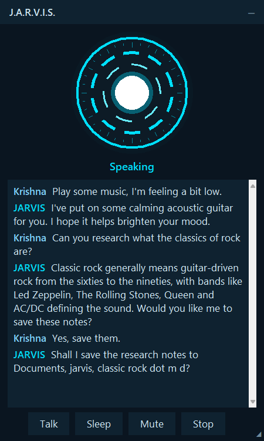

# JARVIS: a voice assistant for your Windows PC

JARVIS is a personal voice assistant that runs on your Windows computer. You talk to it naturally
(say "hey jarvis", click its window, or press a hotkey) and it answers in a calm British voice,
powered by Google's Gemini Live API.

<p align="center"></p>

## What it can do

| | |
|---|---|
| **Talk and research** | Answers questions, researches topics across several web pages, saves notes to `Documents\jarvis` |
| **Your PC** | Opens, closes and switches apps; finds and opens your files by name; volume; battery and system status |
| **Music** | Plays a specific song or artist in your YouTube Music app; pause, next, "what's playing"; lowers the music while you talk |
| **The web** | Opens sites and does short tasks in its own Chrome profile (signed in to your YouTube Premium) |
| **Screen and clipboard** | Looks at your screen when you ask; summarises, translates or fixes text you copied |
| **Your apps** | Reads, types, clicks, presses keys, scrolls and moves windows in any open app ("ask Claude X and read me the answer"); never your browser, password managers or Settings |
| **Multi-step plans** | "Research X, open its official page and tell me the price", or "open Notepad and write a shopping list": you approve the plan once |
| **Memory and reminders** | Remembers what you ask it to; reminders that survive a restart, with Windows notifications |
| **Desktop app** | Animated window with the full conversation and a box to type to JARVIS, tray icon, taskbar pin, offline wake word trained on your voice, background-noise suppression |

## Safe by design

- **Nothing that changes anything happens without *your* yes**: your own voice, heard after JARVIS
  has finished speaking, or a hotkey. The model can't approve its own actions.
- **Web pages, the screen and the clipboard can't give orders.** Their content is marked as
  untrusted, and after reading it every action needs your confirmation.
- **Hard limits in code:** no password or payment fields (in web pages or apps), no reading your own
  browser, password managers or Windows Settings, no account pages or account switching
  (so other members of a YouTube family plan stay private), no shell, no deleting files, no
  messaging or purchases.
- **Everything is logged** to `logs/actions.jsonl`, with secrets redacted.

Details: [docs/safety.md](docs/safety.md).

## Quick start

You need Windows 10 or 11, Google Chrome, and a free [Gemini API key](https://aistudio.google.com/apikey).

```bash
pip install --user uv
python -m uv sync --extra wakeword
copy .env.example .env
```

Put your key after `GOOGLE_API_KEY=` in `.env`, then:

```bash
.\run.bat
```

Say **"hey jarvis"**. For the full setup (microphone test, training the wake word on your voice,
signing JARVIS's browser in to YouTube, the desktop and taskbar icon), see the
[user guide](docs/user-guide.md#setup).

## Documentation

| Guide | For |
|---|---|
| [User guide](docs/user-guide.md) | Setup, everyday use, voice commands, the window and tray, wake word, troubleshooting |
| [Safety and privacy](docs/safety.md) | Tiers, the confirmation protocol, untrusted content, plan freeze, privacy rules, audit log |
| [Architecture](docs/architecture.md) | How the pieces fit: audio pipeline, Gemini session, dispatcher, threads, storage |
| [Configuration](docs/configuration.md) | Every setting in `config.yaml` and `.env`, and the command-line options |
| [Developer guide](docs/developer-guide.md) | Adding a capability, tests, conventions, debugging |
| [Changelog](CHANGELOG.md) | How JARVIS was built, phase by phase |

## Project layout

```
jarvis/
├── main.py            entry point and command-line options
├── run.bat            starts JARVIS in a terminal (the desktop icon starts it as an app)
├── config.yaml        all settings, commented
├── .env.example       copy to .env and add your keys (never committed)
├── core/              runtime, Gemini session, dispatcher and safety, audio, window, tray
├── actions/           one module per capability (system, web, browser, media, ...)
├── tests/             offline test suite (a fake Gemini Live session drives the real dispatcher)
├── docs/              the guides above
├── assets/            the JARVIS icon
├── data/              git-ignored: memory, reminders, browser profile, caches, wake-word clips
└── logs/              git-ignored: app log, console output, audit log
```

## Tech

Python 3.12 managed with [uv](https://docs.astral.sh/uv/) · Gemini Live (voice) and Gemini Flash
(text, planning, vision) via `google-genai` · openWakeWord (offline wake word) · RNNoise (noise
suppression) · Playwright with installed Chrome · pywinauto (UI Automation) · ytmusicapi and
Windows media sessions · APScheduler · Tkinter and pystray (window and tray) · pytest.

This is a private project, not affiliated with Google, Marvel or any film.
