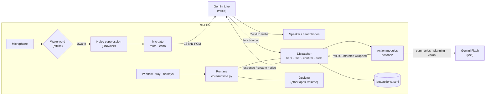
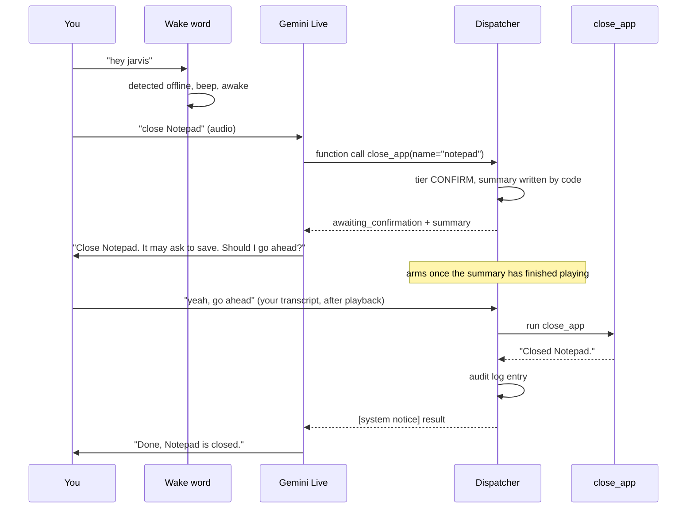

# Architecture

- [The big picture](#the-big-picture)
- [A request, end to end](#a-request-end-to-end)
- [Audio pipeline](#audio-pipeline)
- [The Gemini session](#the-gemini-session)
- [Dispatcher and tools](#dispatcher-and-tools)
- [Voice and chat: one conversation, one event bus](#voice-and-chat-one-conversation-one-event-bus)
- [The orb and the chat page (ui/)](#the-orb-and-the-chat-page-ui)
- [Threads](#threads)
- [Startup, single instance and shutdown](#startup-single-instance-and-shutdown)
- [Where data lives](#where-data-lives)

## The big picture

The main parts:
- **Gemini Live** is the conversation. It hears you, speaks, transcribes both sides, and decides
  when to call a tool.
- **The dispatcher** is the only path from the model to a tool, and it's where every safety rule
  lives (see [safety.md](safety.md)).
- **Action modules** do the work. Heavy one-shot jobs go to a cheaper **Gemini Flash** text call:
  summarising pages, planning, reading a screenshot. `core/llm.py` handles the Flash fallback
  chain, retries, timeouts and daily-quota skipping.
- **The runtime** wires it together: audio devices, wake state, hotkeys, window, tray, reminders,
  ducking and the ticker.

## A request, end to end

This is what happens when you say "hey jarvis, close Notepad", which needs confirmation:

A SAFE call, such as the weather, skips the confirmation and returns its result directly.

## Audio pipeline

The pieces:
- **Input:** `sounddevice` at 16 kHz in 80 ms blocks, from the Windows default mic or
  `audio.input_device`.
- **Wake word** (`core/wakeword.py`): while asleep, blocks go only to openWakeWord, optionally
  checked by your personal verifier. Nothing is sent anywhere.
- **Noise suppression** (`core/denoise.py`): once awake, blocks are cleaned by RNNoise on a worker
  thread, resampled 16 to 48 to 16 kHz with soxr, keeping the same block sizes. The wake word
  always hears the raw mic, because the verifier was trained on it.
- **Mic gate** (`core/audio.py`): mute, push-to-talk, the speaker echo gate, and the rule that
  audio which might be echo is never sent while a confirmation is pending.
- **Output:** a player at 24 kHz, and the stop hotkey drops the rest of a reply. The runtime
  follows Windows default-device changes (Bluetooth connects and disconnects) and picks the echo
  mode from the output device's name.
- **Ducking** (`core/ducking.py`): while awake, other apps' volumes are lowered through Windows
  per-app volume (pycaw) and restored on sleep. JARVIS's own session is never touched, and saved
  volumes are written to `data/ducking.json` so a crash can't leave them lowered.

## The Gemini session

`core/session.py` keeps one Live session:
- **Config:** the voice, input and output transcription, sliding-window context compression,
  session resumption, and the tool declarations (every tool is a blocking function call).
- **Reconnects:** with backoff and resumption. A handle that fails twice in a row is dropped, and
  after 3 failures in 5 minutes JARVIS tells you and backs off.
- **Context after a drop:** when Gemini kills a session (e.g. close code 1011) and resumption fails
  or there's no handle yet, the new session would start blank. Instead it's seeded with a recap of
  the last 8 finished lines (`Transcript.recent`, via `LiveSession(recap=...)` and `build_recap`):
  text only, each line trimmed, wrapped as `<untrusted_content>` (spoken replies may echo web pages),
  sent as context with `turn_complete=False` so the model waits for you. It never carries tool
  results or confirmation state; pending confirmations stay in the app and only you can confirm. No
  recap on the first connection, after a successful resume, or after a New chat (which clears it).
- **System notices:** the app adds `[system notice]` messages to the conversation, in order.
  They carry confirmation outcomes, reminders, the briefing and "Yes?".
- **System instruction:** rebuilt at each connect by `core/prompts.py`, from the persona, the
  actual capabilities, the confirmation and untrusted-content rules, and your remembered facts.

## Dispatcher and tools

- **Registry** (`core/registry.py`): each module calls `register(Tool(...))` with a name,
  description, JSON schema, tier (fixed, or a function of the arguments), `read_only`,
  `untrusted_output`, `self_gated` and `summarize`. BLOCKED tools are never declared to the model.
- **Dispatcher** (`core/dispatcher.py`):
  - applies taint escalation;
  - creates the single pending action and parks multi-step tools that return `NeedsConfirmation`;
  - runs tools, in a thread if they're blocking, and wraps untrusted output;
  - writes the audit log and sends outcome notices.
- **Confirmer** (`core/confirm.py`): arming after playback, the timeout, accept-phrase matching, and
  echo-safe utterance collection.

The action modules (`actions/`), in load order:

| Module | Tools |
|---|---|
| `system` | datetime, system status, open, close and focus apps, volume |
| `web` | search, read page, weather, save research |
| `browser` | browser open, site search, read current page, close, play YouTube, browser task |
| `media` | play music, media keys and close, music volume, now playing |
| `app_ui` | Older planned UI Automation steps for allowlisted apps (off by default) |
| `desktop` | read, type, click, press keys, scroll and move windows in any open app that isn't off-limits |
| `screen`, `clipboard` | look at the screen, active window, clipboard summarise, translate, explain and fix |
| `memory`, `reminders` | remember, recall, forget, and set, list and cancel reminders |
| `agent_hub` | `agent_hub_request`, `agent_hub_status`: hand work to the Agent Hub over MCP, and announce its results |
| `agent_mode` | `run_plan`, loaded last because it plans over every tool registered before it |

## Background results (Agent Hub)

Modules can run their own loop for JARVIS's lifetime: they append an async function to
`Services.background`, which the runtime starts as a task. The Agent Hub poller uses it to call the
Hub's `get_updates` every few seconds. A result is announced through `Services.notify` (a
`[system notice]`) only when `Services.can_speak()` is true: JARVIS is awake and not talking, running
a tool or waiting for a yes. Otherwise it is held (saved in `data/agent_hub_held.json`) and a toast is
shown once. A confirmation the Hub asks for travels as `NeedsConfirmation`, whose `on_cancel` hook
tells the Hub when the user says no, doesn't answer, or asks for something else.

Long results from tools that opt in (`Tool.condense`: `read_app` except its controls list,
`wait_for_app`, `job_search_status`) are shortened by `core/condense.py` in `Dispatcher._run`,
focused on the user's latest request, before being wrapped and returned to the model. Plan steps
get the full text: the plan's answer step summarises them, and blanks are filled from it.

### JARVIS's skills in the Hub's tool registry

The Hub keeps one catalogue of every tool: its agents' actions, connectors, and JARVIS's own skills.
A request can then be matched to the few tools it needs instead of the whole list. `core/catalog.py`
gives each skill a registry category and keywords; read-only tools are `access: read`, everything
else is `write` (always confirmed on the reasoning path). Meta tools and gateways (`run_plan`,
`think_through`, `agent_hub_request`, task mode...) are left out. A test fails if a new tool has
neither a category nor an exclusion. The poller sends the list with the Hub's `sync_tools` once the
Hub answers, and again whenever it comes back after being unreachable; a Hub without the registry
is asked once and logged. Only names, descriptions, categories, keywords and parameter schemas are
sent. JARVIS still runs its own skills; the Hub only lists them.

### Routing a request to a few tools (core/router.py)

The reasoning layer (in progress) never gets the whole tool list. `Router.route(text)` sorts a request
into one of three routes and attaches between one and eight tools:

| Route | When | Tools attached |
|---|---|---|
| `skill` | one tool clearly fits (high score, clear lead over the next) | that tool and up to two from its category |
| `tools` | tools fit, but not one clearly | the best matches from the matching categories, at least 3 when there are that many |
| `reasoning` | thinking or writing ("should I", "explain", "write a poem"), working out, general facts, or no tool fits | `search_web`, `read_page` (and `get_weather` when asked), plus up to two strongly matching read-only tools |

Candidates come from the Hub's registry (`find_tools`) when it answers within 2.5 s; otherwise (and for
a minute after a failure) from JARVIS's own skills, ranked locally the same way (BM25 with the Hub's
tokens, weights and category words: identical scores on all 82 labelled requests). Cue words per
category boost matching tools; a request with no action verb gets only read-only tools when any fit.
A cue for an area that has no tools yet (mail, calendar, code before their connectors) sends the
request to reasoning and lists the area in `missing`. An optional classifier (a small LLM, for
Phase 4) is asked only when the top score is in a grey zone. Each decision goes to
`logs/routing.jsonl` with a hash of the request, never its text. Try it with
`python main.py --route "what's on my shortlist"`.

### The reasoning layer (actions/brain.py)

`ask_brain` is the voice model's tool for anything that needs thinking, several steps, or a tool it
doesn't have. It routes the request (above), then a Groq model (`core/groq.py`, free tier) works it
with only the attached tools:

- **Limits:** at most `brain.max_steps` model calls (then one last call without tools to answer from
  what was found), 4 tool calls per step, 15 s per model call, 45 s per request, each tool's own
  timeout (`core/catalog.py` TIMEOUTS), results cut to 3000 characters.
- **Rate limits:** a 429 with a short retry-after is waited out once; a longer one skips that model
  until it has passed, so the next model in `groq.models` answers. 5xx errors and timeouts are retried
  once with backoff. A client-side token bucket keeps each model under its free-tier rate.
- **Confirmation gate:** a JARVIS skill that isn't read-only, or whose tier is CONFIRM right now
  (including taint), pauses the loop with `NeedsConfirmation`: JARVIS's normal confirmation (summary
  written by code from the tool's own `summarize`, the user's own yes, timeout, audit). An Agent Hub
  tool runs through the Hub's `call_tool`, which refuses denied actions and, for a write, returns
  the Hub's own question instead of running; JARVIS asks it, and only the user's yes sends
  `confirmed=true`. The model has no confirm tool and can't call tools it wasn't given.
- **Execution:** JARVIS skills run through `Dispatcher.run_step` (audit, untrusted wrapping, taint),
  with `APPROVED_STEP` set only after a yes; Hub results are wrapped as untrusted and taint the turn.
- **Answer:** plain spoken sentences (`speakable`: no markdown, lists, links or code), wrapped as
  data for the voice model like every web-based result.
- **Fallback:** without Groq (no key, rate-limited, down) a reasoning request goes to the Gemini Flash
  chain with JARVIS's web search (what `think_through` did), and tool work is handed back to the voice
  model with the names of its own tools that fit.
- **Log:** `logs/brain.jsonl`, one line per request: a hash, the route, outcome, models, steps, tool
  names and statuses, tokens and time. No request text, arguments or results.

`python main.py --ask "..."` runs one request this way in the terminal and never says yes.

## Voice and chat: one conversation, one event bus

Voice and chat share one brain: the same Live conversation, tools, dispatcher, memory and
confirmations.
- **Voice** is the mic, the wake word and Gemini Live's transcription.
- **Chat** is typed text from any surface: the window's box, the terminal in `--text` mode, and later
  the web UI. All of them go through `core/channels.py` `ChatChannel.send(text, speak, source)`, which
  is safe from any thread. A typed "yes" answers a pending confirmation, because it comes from the
  user's keyboard. `speak=False` gives a text-only answer.

Everything the conversation says and does is published once on `core/bus.py`'s `EventBus`
(`Assistant.bus`, also `Services.bus`):

| Event | Published by | Data |
|---|---|---|
| `partial`, `message` | the transcript | role, text (`message` also: label, source) |
| `tool_started`, `tool_finished` | the dispatcher, for every run including plan steps | tool, args (secrets hidden), result (cut), step, paused |
| `confirm_requested`, `confirm_resolved` | the dispatcher | id, tool, summary / outcome, result |
| `state` | the ticker, on change | starting, asleep, listening, speaking, working, muted |
| `notice` | `_notify` | first line of a `[system notice]` |
| `status` | the runtime | console lines such as `(awake)` and `[tool] …` |

Each event's `channel` is `voice` or `chat`, the channel of the user's latest input, or `None` for
the app itself. Views subscribe:
- The console (`ConsoleSink`) prints messages and status lines as before.
- A WebSocket can use `bus.stream()`, a bounded async iterator that drops the oldest events if it
  falls behind, together with `bus.recent()` to catch up.

Events are delivered in order on the asyncio loop. A subscriber that fails is logged and skipped.
Event text can come from web pages and apps, so views show it as plain text, and nothing a view
receives can confirm an action.

## The orb and the chat page (ui/)

`features.web_ui` replaces the Tk window with two views of one conversation, both local web pages:
- **The orb** (`/`, `ui/static/index.html`, `app.js`) is a quick-action control centre.
  - It's drawn in 3D by `orb3d.js`, with Three.js 0.186.1 stored in `ui/static/vendor/three`. Nothing is
    loaded from the internet, and the add-ons' imports are rewritten to relative paths because the
    page's security policy allows no import map. It's the user's reference design on the graphics card:
    - "Cloud and core", which Krishna designed from the mock-ups;
    - outside: a soft cloud of light points shaped like a sphere that slowly breathes, with no lines or
      rings; when JARVIS speaks it swirls and bulges with the voice;
    - inside: an arc reactor like Iron Man's (Krishna picked it from ten inner shapes): a glowing
      nucleus, an inner ring, ten segments that light up in a chase while JARVIS is busy, and an outer
      ring with ticks, gently tilting; the cloud is 1.2 times the reactor's size;
    - around the cloud, hugging it: three glowing Möbius ribbons (the first orb's orbit bands with a half
      twist) with flowing light and a comet each, and lightning along them while JARVIS speaks;
    - a bloom glow using only the tighter blur layers (the widest ones fogged the desktop);
    - each part has its own brightness: `web_ui.orb_brightness` (the core, 0.55) and
      `web_ui.cloud_brightness` (the cloud, 0.45);
    - Customize (a button in the control bar) has sliders for the orb's size, the core's size and the
      core's, the cloud's and the ribbons' brightness. They apply live (the window resizes around the same centre: `jarvis:size`), and
      `WebBridge.set_look` keeps them in `data/orb_look.json`, which wins over `config.yaml`.
  - A last pass sets each pixel's alpha from its brightness, so the glow blends into the desktop.
    Without WebGL, `orb.js` draws the 2D version (`#orb=2d` forces it).
  - When idle, it's only the orb, about 112 px across (`web_ui.orb_size`). It's low when asleep,
    brighter when listening and strongest when speaking; grey when muted, amber while working on a task,
    and red when something JARVIS needs isn't working, with the reason under it (`WebBridge.problem`:
    the voice session not connected after 20 s, or the Agent Hub unreachable; it rides on `level`).
  - Tap it for the radial menu: Chat, Talk and Command centre, three round buttons under the orb (the
    window expands as for the control centre; the buttons are reported as click-through shapes). It
    closes after a choice, Esc, or 8 s. Hold it (550 ms) to talk; double-tap to mute or unmute. Drag it
    anywhere on the screen; it stays where it's left. `hotkeys.show_orb` (Ctrl+Alt+Space) hides and
    shows it: the bus's `orb_visibility` reaches the page, which tells its window `jarvis:hide`/`show`.
  - The older control centre (opened with `#open=1` in previews; its Customize sliders now live in the
    app's Settings › Appearance) is stacked under the orb:
    - a controls bar: Talk, Mute, New chat, Stop, Sleep, Customize;
    - the sections a reply needs (the answer, a confirmation with Confirm / Cancel, a picture, what's
      playing), in the order they came;
    - the typing box;
    - quick-action chips (`web_ui.quick_actions`).
  - Voice mode: if the orb was closed, a reply shows only its sections (the answer as a short caption,
    a confirmation, a picture, what's playing) under the orb, with no controls, typing box or chips.
    They fade after `web_ui.caption_seconds` (8 s) once JARVIS has finished; a confirmation stays until
    it's answered. Double-tap opens the full control centre around them.
  - Double-tap again, Esc, or JARVIS going to sleep closes it back to just the orb.
  - The page uses no CSS animations or transitions. In the see-through Qt window the browser engine
    doesn't advance them, so fades stopped halfway and left cards half see-through. Fades and slides
    run on animation frames in `app.js` instead.
- **The app** (`/app`, `ui/static/app/`) is the complete interface, in its own normal window; it
  replaced the older chat page (`/chat` is still served but nothing opens it). The orb's Chat and
  Command centre, New chat and the old Settings button open it on a section (`#s=chat|command|memory|settings`;
  a `focus` event with `target: "app"` switches section when it's already open). Preact 10.29.8 + htm
  3.1.1 as plain modules (no build step; `ui/static/vendor`), Lucide icons from a 48-icon sprite,
  `ui/static/shared/` for the connection (`ws.js`: events, and requests that get one reply), a small
  store and the dark cyan theme. Sections, from an icon sidebar (split view puts Chat and the Command
  centre side by side):
  - **Chat**: the conversation as turns (what you said, then JARVIS's replies, tool chips, plan cards
    with Approve / Cancel, pictures), reply actions (copy, regenerate the last, pin to memory), and a
    context panel per answer: tools with their status (`tool_finished.ok`), web sources (`sources`:
    titles and sites, never links) and memory used (`memory_used`). The composer sends, stops, talks,
    attaches pictures (`/upload`) or the screen (`/snap`), and sets web search auto / on / off for one
    message (off refuses the web tools for it: `Dispatcher.turn_blocked`).
  - **Command centre**: a status strip (`WebBridge.status`: voice session; the Agent Hub, its planner
    and each agent from the Hub's `agent_status`; which model does what; the last route; tools loaded
    here vs in the Hub's registry) and a live timeline of tools, confirmations, agent results
    (`agent_update`) and routing decisions (`route`, from `ask_brain`, never the request's text).
  - **Memory**: remembered facts (Forget asks once more) and kept conversations (memory step 4).
  - **Settings**: see docs/configuration.md; changes are checked by `core/settings_store.py`.
- **New chat** (`Assistant.new_conversation`): the Live session reconnects without its resumption
  handle, so the model starts fresh (`LiveSession.new_conversation`), with no recap carried over. The bus publishes `conversation`,
  views clear, and a page that connects later only gets the history since then. Memory, reminders and
  settings are untouched.
- **Server** (`ui/server.py`): FastAPI and uvicorn, run as a task inside JARVIS's own asyncio loop,
  bound to 127.0.0.1 only. uvicorn's Ctrl+C handling is switched off, because JARVIS owns shutdown. It
  serves both pages and one WebSocket.
- **Windows** (`ui/window.py`): Qt WebEngine (PySide6), each in a child process
  (`python -m ui.window --mode orb|chat …`).
  - Qt has to own its process's main thread, and JARVIS's main thread runs the asyncio loop. A crash in
    the browser engine also can't take the assistant down that way.
  - The orb window is frameless with a transparent background (per-pixel alpha), so the glow blends into
    the desktop. Edge WebView2 can't do this on Windows; that was tested on this PC.
  - The orb window resizes between just the orb and the control centre (a 420 x 720 column with the orb
    at its top), keeping the orb in place, or moving it inward near a screen edge and back when it closes.
    Until the page reports its shapes, the orb itself takes clicks.
  - Everywhere the page draws nothing, clicks go through. The page reports its clickable shapes
    (`jarvis:shape` console lines), and a 30 ms timer turns `WS_EX_TRANSPARENT` on or off as the mouse
    moves over them.
  - Each window shares JARVIS's taskbar ID and remembers its place (`data/orb_window.json`,
    `data/chat_window.json`).
  - Closing the orb (Alt+F4) quits JARVIS, or with `web_ui.close_button: hide` keeps it running in the
    tray. Closing the chat window just closes it.
  - Stopping a window ends its whole process tree, because the venv's `python.exe` is a launcher.
- `look_at_screen` publishes a small preview of the capture, with private windows already blacked out,
  as a `media` event. The bus never keeps `media` events in its history, and nothing is saved.

The WebSocket carries the bus (`hello` with a snapshot and recent history, then events, plus `level`
for the orb at up to 15 fps). From the page it accepts: a chat message (through `ChatChannel` as
source `web`, or with a web-search choice or pictures straight to `Assistant.submit_text`); the buttons
the tray and hotkeys already have (talk, sleep, mute, stop, confirm, cancel) and the app's own (voice,
announce, open_app, open_command, open_settings, new_chat); `regenerate`; and requests that get one
reply for that page only (`{type: request|setting|forget|delete_conversation|pin, id}` →
`{kind: "reply", id}`; `status` waits for the Agent Hub without holding up other replies).
Pictures go over plain HTTP (`POST /upload`, `POST /snap`) with the page's Origin and the token in an
`X-Jarvis-Token` header, 10 MB at most; `core/attachments.py` re-encodes them as JPEG and keeps them in
memory for 15 minutes, and the vision model's description reaches the Live model wrapped as untrusted.

**Safety.** WebSockets aren't covered by the browser's same-origin rules, so every connection needs:
- the launch's random token, from the URL's `#fragment` and compared in constant time;
- a Host header of 127.0.0.1 or localhost on this port, which stops DNS rebinding;
- the page's own Origin.

The page sets every text with `textContent`, never as HTML, and runs under a strict
Content-Security-Policy with no inline scripts and no outside connections. Text from web pages can't
run as code there. Confirm is the user's click in JARVIS's own window, the same as the confirm hotkey.

## Threads

| Thread | Does |
|---|---|
| main (asyncio loop) | Gemini session, dispatcher, tools, ticker, reminders scheduler, the web UI's server |
| PortAudio callbacks | mic capture and playback |
| `denoise` | RNNoise, in order; if it falls behind, blocks pass through raw |
| `ducking` | all Windows audio-session (COM) calls |
| `face` | the Tk window (only when `web_ui` is off); it only *reads* state, and clicks go back to the loop |
| (child processes) | the orb and chat windows (`ui/window.py`, Qt WebEngine); they talk to JARVIS only over the WebSocket |
| `uia` | all UI Automation (COM) calls for the desktop tools, so elements found by a read stay usable for focus and clicks |
| `tray` | pystray's message loop |
| pynput | global hotkeys |

Other threads never touch the assistant directly: they hand work to the event loop with
`call_soon_threadsafe`.

## Startup, single instance and shutdown

Handled in `core/app_mode.py` and `core/taskbar.py`.

**Startup**
1. The process sets its taskbar ID (`JARVIS.Desktop.Assistant`), so its window groups with a pin
   made from the desktop icon.
2. When started from an icon, `pythonw.exe` has no console: output goes to `logs/console.txt`, and
   problems appear in a message box.
3. **Single instance:** a named mutex. A second launch waits a few seconds in case the running
   JARVIS is quitting. If it's really running, the second launch signals a named event, the running
   JARVIS brings its window to the front, and the second launch exits.
4. The window shows **Starting up…** before the slow parts load (the wake-word model, the
   denoiser, the tools).

**Shutdown**, which takes about half a second:
1. The music volume is restored.
2. The mutex is released, so a relaunch can start at once.
3. The window hides.
4. Then the tray, denoiser, reminders, tasks, browser and audio stop. Each step's timing is logged.

## Where data lives

| Path | Contents | In git? |
|---|---|---|
| `.env` | API keys | never |
| `config.yaml` | settings | yes |
| `data/models/` | the on-device embedding model from `--setup-memory` (`core/embed.py`) | no |
| `data/memory.sqlite` | long-term memory: remembered facts (and, later, past conversations); an old `memory.json` is imported once and kept as `memory.json.imported` | no |
| `data/reminders.sqlite` | pending reminders (APScheduler job store) | no |
| `data/browser_profile/` | JARVIS's Chrome profile | no |
| `data/wake/` | your wake-word clips and personal verifier | no |
| `data/cache/` | page summaries (24 h) | no |
| `data/window.json` | Tk window size and position | no |
| `data/orb_window.json`, `data/chat_window.json` | where the orb and the chat window were left | no |
| `data/ducking.json` | saved volumes, only while ducked | no |
| `logs/` | `app.log`, `console.txt`, `actions.jsonl`, `window.log` (the web window's own errors) | no |
| `%USERPROFILE%\Documents\jarvis\` | saved research notes | outside the repo |
