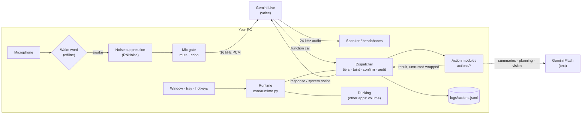
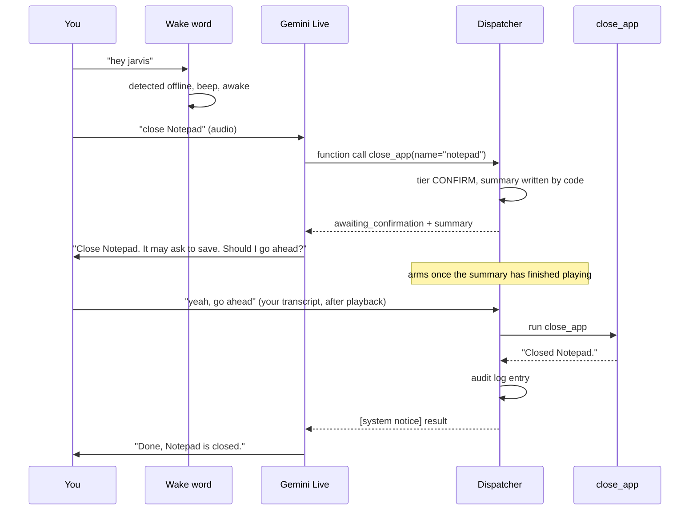

# Architecture

- [The big picture](#the-big-picture)
- [A request, end to end](#a-request-end-to-end)
- [Audio pipeline](#audio-pipeline)
- [The Gemini session](#the-gemini-session)
- [Dispatcher and tools](#dispatcher-and-tools)
- [Voice and chat: one conversation, one event bus](#voice-and-chat-one-conversation-one-event-bus)
- [Threads](#threads)
- [Startup, single instance and shutdown](#startup-single-instance-and-shutdown)
- [Where data lives](#where-data-lives)

## The big picture

The main parts:
- **Gemini Live** is the conversation. It hears you, speaks, transcribes both sides, and decides
  when to call a tool.
- **The dispatcher** is the only path from the model to a tool, and it's where every safety rule
  lives (see [safety.md](safety.md)).
- **Action modules** do the work. Heavy one-shot jobs go to a cheaper **Gemini Flash** text call:
  summarising pages, planning, reading a screenshot. `core/llm.py` handles the Flash fallback
  chain, retries, timeouts and daily-quota skipping.
- **The runtime** wires it together: audio devices, wake state, hotkeys, window, tray, reminders,
  ducking and the ticker.

## A request, end to end

This is what happens when you say "hey jarvis, close Notepad", which needs confirmation:

A SAFE call, such as the weather, skips the confirmation and returns its result directly.

## Audio pipeline

The pieces:
- **Input:** `sounddevice` at 16 kHz in 80 ms blocks, from the Windows default mic or
  `audio.input_device`.
- **Wake word** (`core/wakeword.py`): while asleep, blocks go only to openWakeWord, optionally
  checked by your personal verifier. Nothing is sent anywhere.
- **Noise suppression** (`core/denoise.py`): once awake, blocks are cleaned by RNNoise on a worker
  thread, resampled 16 to 48 to 16 kHz with soxr, keeping the same block sizes. The wake word
  always hears the raw mic, because the verifier was trained on it.
- **Mic gate** (`core/audio.py`): mute, push-to-talk, the speaker echo gate, and the rule that
  audio which might be echo is never sent while a confirmation is pending.
- **Output:** a player at 24 kHz, and the stop hotkey drops the rest of a reply. The runtime
  follows Windows default-device changes (Bluetooth connects and disconnects) and picks the echo
  mode from the output device's name.
- **Ducking** (`core/ducking.py`): while awake, other apps' volumes are lowered through Windows
  per-app volume (pycaw) and restored on sleep. JARVIS's own session is never touched, and saved
  volumes are written to `data/ducking.json` so a crash can't leave them lowered.

## The Gemini session

`core/session.py` keeps one Live session:
- **Config:** the voice, input and output transcription, sliding-window context compression,
  session resumption, and the tool declarations (every tool is a blocking function call).
- **Reconnects:** with backoff and resumption. A handle that fails twice in a row is dropped, and
  after 3 failures in 5 minutes JARVIS tells you and backs off.
- **System notices:** the app adds `[system notice]` messages to the conversation, in order.
  They carry confirmation outcomes, reminders, the briefing and "Yes?".
- **System instruction:** rebuilt at each connect by `core/prompts.py`, from the persona, the
  actual capabilities, the confirmation and untrusted-content rules, and your remembered facts.

## Dispatcher and tools

- **Registry** (`core/registry.py`): each module calls `register(Tool(...))` with a name,
  description, JSON schema, tier (fixed, or a function of the arguments), `read_only`,
  `untrusted_output`, `self_gated` and `summarize`. BLOCKED tools are never declared to the model.
- **Dispatcher** (`core/dispatcher.py`):
  - applies taint escalation;
  - creates the single pending action and parks multi-step tools that return `NeedsConfirmation`;
  - runs tools, in a thread if they're blocking, and wraps untrusted output;
  - writes the audit log and sends outcome notices.
- **Confirmer** (`core/confirm.py`): arming after playback, the timeout, accept-phrase matching, and
  echo-safe utterance collection.

The action modules (`actions/`), in load order:

| Module | Tools |
|---|---|
| `system` | datetime, system status, open, close and focus apps, volume |
| `web` | search, read page, weather, save research |
| `browser` | browser open, site search, read current page, close, play YouTube, browser task |
| `media` | play music, media keys and close, music volume, now playing |
| `app_ui` | Older planned UI Automation steps for allowlisted apps (off by default) |
| `desktop` | read, type, click, press keys, scroll and move windows in any open app that isn't off-limits |
| `screen`, `clipboard` | look at the screen, active window, clipboard summarise, translate, explain and fix |
| `memory`, `reminders` | remember, recall, forget, and set, list and cancel reminders |
| `agent_hub` | `agent_hub_request`, `agent_hub_status`: hand work to the Agent Hub over MCP, and announce its results |
| `agent_mode` | `run_plan`, loaded last because it plans over every tool registered before it |

## Background results (Agent Hub)

Modules can run their own loop for JARVIS's lifetime: they append an async function to
`Services.background`, which the runtime starts as a task. The Agent Hub poller uses it to call the
Hub's `get_updates` every few seconds. A result is announced through `Services.notify` (a
`[system notice]`) only when `Services.can_speak()` is true: JARVIS is awake and not talking, running
a tool or waiting for a yes. Otherwise it is held (saved in `data/agent_hub_held.json`) and a toast is
shown once. A confirmation the Hub asks for travels as `NeedsConfirmation`, whose `on_cancel` hook
tells the Hub when the user says no, doesn't answer, or asks for something else.

Long results from tools that opt in (`Tool.condense`: `read_app` except its controls list,
`wait_for_app`, `job_search_status`) are shortened by `core/condense.py` in `Dispatcher._run`,
focused on the user's latest request, before being wrapped and returned to the model. Plan steps
get the full text: the plan's answer step summarises them, and blanks are filled from it.

## Voice and chat: one conversation, one event bus

Voice and chat share one brain: the same Live conversation, tools, dispatcher, memory and
confirmations.
- **Voice** is the mic, the wake word and Gemini Live's transcription.
- **Chat** is typed text from any surface: the window's box, the terminal in `--text` mode, and later
  the web UI. All of them go through `core/channels.py` `ChatChannel.send(text, speak, source)`, which
  is safe from any thread. A typed "yes" answers a pending confirmation, because it comes from the
  user's keyboard. `speak=False` gives a text-only answer.

Everything the conversation says and does is published once on `core/bus.py`'s `EventBus`
(`Assistant.bus`, also `Services.bus`):

| Event | Published by | Data |
|---|---|---|
| `partial`, `message` | the transcript | role, text (`message` also: label, source) |
| `tool_started`, `tool_finished` | the dispatcher, for every run including plan steps | tool, args (secrets hidden), result (cut), step, paused |
| `confirm_requested`, `confirm_resolved` | the dispatcher | id, tool, summary / outcome, result |
| `state` | the ticker, on change | starting, asleep, listening, speaking, working, muted |
| `notice` | `_notify` | first line of a `[system notice]` |
| `status` | the runtime | console lines such as `(awake)` and `[tool] …` |

Each event's `channel` is `voice` or `chat`, the channel of the user's latest input, or `None` for
the app itself. Views subscribe:
- The console (`ConsoleSink`) prints messages and status lines as before.
- A WebSocket can use `bus.stream()`, a bounded async iterator that drops the oldest events if it
  falls behind, together with `bus.recent()` to catch up.

Events are delivered in order on the asyncio loop. A subscriber that fails is logged and skipped.
Event text can come from web pages and apps, so views show it as plain text, and nothing a view
receives can confirm an action.

## Threads

| Thread | Does |
|---|---|
| main (asyncio loop) | Gemini session, dispatcher, tools, ticker, reminders scheduler |
| PortAudio callbacks | mic capture and playback |
| `denoise` | RNNoise, in order; if it falls behind, blocks pass through raw |
| `ducking` | all Windows audio-session (COM) calls |
| `face` | the Tk window; it only *reads* state, and clicks go back to the loop |
| `uia` | all UI Automation (COM) calls for the desktop tools, so elements found by a read stay usable for focus and clicks |
| `tray` | pystray's message loop |
| pynput | global hotkeys |

Other threads never touch the assistant directly: they hand work to the event loop with
`call_soon_threadsafe`.

## Startup, single instance and shutdown

Handled in `core/app_mode.py` and `core/taskbar.py`.

**Startup**
1. The process sets its taskbar ID (`JARVIS.Desktop.Assistant`), so its window groups with a pin
   made from the desktop icon.
2. When started from an icon, `pythonw.exe` has no console: output goes to `logs/console.txt`, and
   problems appear in a message box.
3. **Single instance:** a named mutex. A second launch waits a few seconds in case the running
   JARVIS is quitting. If it's really running, the second launch signals a named event, the running
   JARVIS brings its window to the front, and the second launch exits.
4. The window shows **Starting up…** before the slow parts load (the wake-word model, the
   denoiser, the tools).

**Shutdown**, which takes about half a second:
1. The music volume is restored.
2. The mutex is released, so a relaunch can start at once.
3. The window hides.
4. Then the tray, denoiser, reminders, tasks, browser and audio stop. Each step's timing is logged.

## Where data lives

| Path | Contents | In git? |
|---|---|---|
| `.env` | API keys | never |
| `config.yaml` | settings | yes |
| `data/memory.json` | remembered facts | no |
| `data/reminders.sqlite` | pending reminders (APScheduler job store) | no |
| `data/browser_profile/` | JARVIS's Chrome profile | no |
| `data/wake/` | your wake-word clips and personal verifier | no |
| `data/cache/` | page summaries (24 h) | no |
| `data/window.json` | window size and position | no |
| `data/ducking.json` | saved volumes, only while ducked | no |
| `logs/` | `app.log`, `console.txt`, `actions.jsonl` | no |
| `%USERPROFILE%\Documents\jarvis\` | saved research notes | outside the repo |
